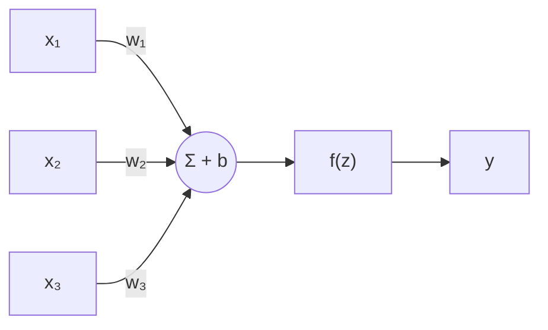
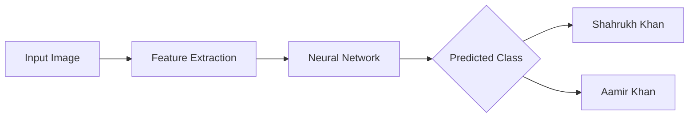
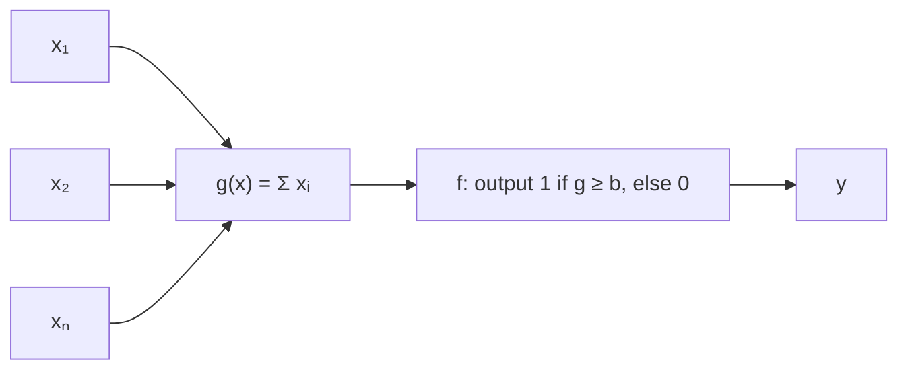

# Deep Learning Notes: From Neurons to the McCulloch-Pitts Model
---

## Table of Contents

- [Deep Learning](#deep-learning)
- [Biological Neuron](#biological-neuron)
- [Artificial Neuron (General Model)](#artificial-neuron-general-model)
- [Classification Example: Shahrukh Khan vs Aamir Khan](#classification-example-shahrukh-khan-vs-aamir-khan)
- [McCulloch-Pitts (MP) Neuron](#mcculloch-pitts-mp-neuron)
  - [Key Properties](#key-properties)
  - [Mathematical Definition](#mathematical-definition)
  - [How to Find the Minimum Threshold b](#how-to-find-the-minimum-threshold-b)
- [Solved Examples (from the Slide)](#solved-examples-from-the-slide)
  - [Logical AND](#logical-and)
  - [Logical OR](#logical-or)
  - [Identity Function](#identity-function)
  - [Inhibitory Function](#inhibitory-function)
- [How the MP Neuron Attempts to Learn](#how-the-mp-neuron-attempts-to-learn)
  - [Problem Setup](#problem-setup)
  - [Training Data](#training-data)
  - [Predictions for Each Threshold](#predictions-for-each-threshold)
  - [Comparing Predictions with the Actual Output](#comparing-predictions-with-the-actual-output)
  - [Takeaways](#takeaways)
- [Limitations of the MP Neuron](#limitations-of-the-mp-neuron)
- [Quick Reference Summary](#quick-reference-summary)
- [Extra Practice Problems](#extra-practice-problems)
- [The Equation of a Line](#the-equation-of-a-line)
  - [Basic Forms](#basic-forms)
  - [Worked Example](#worked-example)
  - [Graph of the Line](#graph-of-the-line)
  - [Points On, Above and Below the Line](#points-on-above-and-below-the-line)
  - [Slope and Angle](#slope-and-angle)
  - [Extension to Multiple Dimensions](#extension-to-multiple-dimensions)
  - [Connection to the MP Neuron](#connection-to-the-mp-neuron)
  
---

## Deep Learning

**Deep Learning** is a subset of **Machine Learning** that uses Artificial Neural Networks (ANNs) with multiple hidden layers to learn complex patterns from data. It is loosely inspired by the brain.

**Applications:** image recognition, speech recognition, NLP, self-driving cars, recommendation systems.

---

## Biological Neuron

| Component | Role |
|---|---|
| **Dendrites** | Receive signals from other neurons |
| **Soma (cell body)** | Processes the incoming signals |
| **Axon** | Carries the output signal onward |
| **Synapse** | Junction where one neuron passes a signal to the next |

The brain has billions of interconnected neurons and learns through experience. This is the inspiration for ANNs.

---

## Artificial Neuron (General Model)

**Steps:** receive inputs → multiply by weights → sum → add bias → apply activation → output.

$$
z = \sum_{i=1}^{n} w_i x_i + b
$$

$$
y = f(z)
$$

| Symbol | Meaning |
|---|---|
| $x_i$ | Input $i$ |
| $w_i$ | Weight of input $i$ |
| $b$ | Bias |
| $f(\cdot)$ | Activation function |
| $y$ | Output |



---

## Classification Example: Shahrukh Khan vs Aamir Khan

- **Input features:** face shape, eye shape, hairstyle, beard pattern, facial measurements.
- **Output classes:** Class 1 = Shahrukh Khan, Class 2 = Aamir Khan.
- **Type:** **Binary classification**, since there are only two possible outputs.



---

## McCulloch-Pitts (MP) Neuron

Proposed by **Warren McCulloch and Walter Pitts (1943)**, it was the first mathematical model of an artificial neuron.

### Key Properties

- Inputs are **binary** ($0$ or $1$), and the output is **binary**.
- Two parts: **g** (aggregation) and **f** (threshold decision).
- Inputs can be **excitatory** (they add to the sum) or **inhibitory** (if one is active, the output is forced to $0$).
- There are **no learnable weights**. The threshold $b$ is set by hand.



### Mathematical Definition

**Aggregation (g):**

```
          n
g(x)  =   Σ   xᵢ
         i=1
```

**Decision (f):**

```
               ⎧ 1,   if g(x) ≥ b
y = f(g(x)) =  ⎨
               ⎩ 0,   if g(x) < b
```

**With an inhibitory input:**

```
y = 0                if any inhibitory input = 1
y = f(g(x))          otherwise
```

Here **b** is the threshold (also called bias, and written θ in some textbooks).

### How to Find the Minimum Threshold b

1. For every row where y = 1, compute g(x). Take the **smallest** value: call it **g₁**.
2. For every row where y = 0, compute g(x). Take the **largest** value: call it **g₀**.
3. A valid threshold must satisfy:

```
g₀  <  b  ≤  g₁
```

The **minimum** valid integer threshold is **b = g₀ + 1**.
---

## Solved Examples (from the Slide)


Legend: `──►` is a normal (excitatory) connection, `══►` is a doubled connection (the input is counted twice), and `●` marks an **inhibitory** input.

### Logical AND

```
  x₁ ────────►╭─────┬─────╮
              │  g  │  f  ├────► y
  x₂ ────────►╰─────┴─────╯
```

| x₁ | x₂ | g = x₁ + x₂ | y |
|:-:|:-:|:-:|:-:|
| 0 | 0 | 0 | 0 |
| 0 | 1 | 1 | 0 |
| 1 | 0 | 1 | 0 |
| 1 | 1 | 2 | 1 |

```
g₀ = 1  (largest g where y = 0)
g₁ = 2  (smallest g where y = 1)

1 < b ≤ 2   ⟹   minimum b = 2

Rule:  y = 1  if  x₁ + x₂ ≥ 2
```

---

### Logical OR

```
  x₁ ═══(×2)═►╭─────┬─────╮
              │  g  │  f  ├────► y
  x₂ ═══(×2)═►╰─────┴─────╯
```

| x₁ | x₂ | g = 2x₁ + 2x₂ | y |
|:-:|:-:|:-:|:-:|
| 0 | 0 | 0 | 0 |
| 0 | 1 | 2 | 1 |
| 1 | 0 | 2 | 1 |
| 1 | 1 | 4 | 1 |

```
g₀ = 0,  g₁ = 2

0 < b ≤ 2

Slide answer:  b = 2
Rule:          y = 1  if  2x₁ + 2x₂ ≥ 2
```

> With a **single** line per input, g = x₁ + x₂ and OR needs only **b = 1**.

---

### Identity Function

```
  x  ═══(×2)═►╭─────┬─────╮
              │  g  │  f  ├────► y
              ╰─────┴─────╯
```

| x | g = 2x | y |
|:-:|:-:|:-:|
| 0 | 0 | 0 |
| 1 | 2 | 1 |

```
g₀ = 0,  g₁ = 2

0 < b ≤ 2

Slide answer:  b = 2
Rule:          y = 1  if  2x ≥ 2
```

> With a **single** line, g = x and the identity function needs only **b = 1**.

---

### Inhibitory Function

Implements: **x₁ AND NOT x₂**. The red dot on the slide marks x₂ as inhibitory.

```
  x₁ ────────►╭─────┬─────╮
              │  g  │  f  ├────► y
  x₂ ──────●─►╰─────┴─────╯
           ▲
       inhibitory
```

| x₁ | x₂ | NOT x₂ | y |
|:-:|:-:|:-:|:-:|
| 0 | 0 | 1 | 0 |
| 0 | 1 | 0 | 0 |
| 1 | 0 | 1 | 1 |
| 1 | 1 | 0 | 0 |

```
y = [ g(x) ≥ b ]  AND  (NOT x₂)

Slide:  y = (1 if g(x) ≥ 2) AND (NOT x₂)   ⟹   b = 2
```

How it works:

- If x₂ = 1, the inhibitory input forces y = 0, whatever x₁ is.
- If x₂ = 0, the neuron behaves like a plain threshold unit on x₁.

---


## How the MP Neuron Attempts to Learn

### Problem Setup

- Data for **10 suspected cancer patients (P1 to P10)** is given across **9 attributes** (x₁ to x₉). The table also shows whether malignancy is actually present (**y**).
- The attributes are **boolean**, binarized using some criterion. Example: if radius ≥ 10 mm then x₂ = 1, otherwise 0.
- The **count of 1's** for each patient is also shown.
- The table is the **training data**. The objective is to prepare an MP neuron that predicts malignancy (ŷ) for a new patient from the 9 boolean attributes.
- **Learning** here means finding the threshold **b** so that the neuron's output ŷ matches the true malignancy y as closely as possible.
- b can range only from **0 to n**, where n is the number of attributes. Here n = 9.
- For each b from 0 to 9, the predicted value ŷ is calculated.

```
  x₁ ──►┐
  x₂ ──►┤   ╭───────┬───────╮
   ⋮    ├──►│   g   │   f   ├───► ŷ
  x₉ ──►┘   ╰───────┴───────╯

              9
  g(x)  =     Σ   xᵢ          (the count of 1's)
             i=1

               ⎧ 1,   if g(x) ≥ b
  ŷ = f(g(x)) = ⎨
               ⎩ 0,   if g(x) < b
```

### Training Data

Cancer data for 10 patients across 9 attributes:

| Attribute | P1 | P2 | P3 | P4 | P5 | P6 | P7 | P8 | P9 | P10 |
|---|:-:|:-:|:-:|:-:|:-:|:-:|:-:|:-:|:-:|:-:|
| x₁ Diagnosis | 0 | 1 | 1 | 0 | 0 | 1 | 0 | 1 | 1 | 0 |
| x₂ Radius | 1 | 0 | 1 | 0 | 0 | 0 | 1 | 0 | 0 | 1 |
| x₃ Texture | 1 | 0 | 1 | 0 | 1 | 0 | 1 | 0 | 1 | 0 |
| x₄ Concavity | 1 | 1 | 0 | 0 | 0 | 1 | 0 | 1 | 0 | 0 |
| x₅ Compactness | 1 | 1 | 1 | 1 | 1 | 1 | 1 | 1 | 1 | 0 |
| x₆ Smoothness | 0 | 1 | 1 | 0 | 1 | 0 | 1 | 1 | 1 | 0 |
| x₇ Perimeter | 1 | 0 | 0 | 1 | 1 | 1 | 0 | 0 | 0 | 0 |
| x₈ Protein Test | 0 | 0 | 0 | 1 | 0 | 1 | 0 | 1 | 0 | 0 |
| x₉ Inflammation | 0 | 1 | 1 | 0 | 0 | 0 | 1 | 1 | 1 | 0 |
| **Count of 1's (g)** | **5** | **5** | **6** | **3** | **4** | **5** | **5** | **6** | **5** | **1** |
| **Malignancy (y)** | **1** | **1** | **1** | **0** | **0** | **1** | **1** | **1** | **0** | **0** |

### Predictions for Each Threshold

Since the MP neuron only uses the count of 1's, **ŷ = 1 exactly when the count ≥ b**.

| Threshold | P1 | P2 | P3 | P4 | P5 | P6 | P7 | P8 | P9 | P10 |
|---|:-:|:-:|:-:|:-:|:-:|:-:|:-:|:-:|:-:|:-:|
| **Actual y** | **1** | **1** | **1** | **0** | **0** | **1** | **1** | **1** | **0** | **0** |
| b = 0, ŷ | 1 | 1 | 1 | 1 | 1 | 1 | 1 | 1 | 1 | 1 |
| b = 1, ŷ | 1 | 1 | 1 | 1 | 1 | 1 | 1 | 1 | 1 | 1 |
| b = 2, ŷ | 1 | 1 | 1 | 1 | 1 | 1 | 1 | 1 | 1 | 0 |
| b = 3, ŷ | 1 | 1 | 1 | 1 | 1 | 1 | 1 | 1 | 1 | 0 |
| b = 4, ŷ | 1 | 1 | 1 | 0 | 1 | 1 | 1 | 1 | 1 | 0 |
| b = 5, ŷ | 1 | 1 | 1 | 0 | 0 | 1 | 1 | 1 | 1 | 0 |
| b = 6, ŷ | 0 | 0 | 1 | 0 | 0 | 0 | 0 | 1 | 0 | 0 |
| b = 7, ŷ | 0 | 0 | 0 | 0 | 0 | 0 | 0 | 0 | 0 | 0 |
| b = 8, ŷ | 0 | 0 | 0 | 0 | 0 | 0 | 0 | 0 | 0 | 0 |
| b = 9, ŷ | 0 | 0 | 0 | 0 | 0 | 0 | 0 | 0 | 0 | 0 |

The slide colors matching predictions blue and mismatches orange.

### Comparing Predictions with the Actual Output

> This section is my own calculation from the slide's table (the slide stops at the predictions). Errors are patients where ŷ ≠ y.

| b | Wrong patients | Errors | Accuracy |
|:-:|---|:-:|:-:|
| 0 | P4, P5, P9, P10 | 4 | 60% |
| 1 | P4, P5, P9, P10 | 4 | 60% |
| 2 | P4, P5, P9 | 3 | 70% |
| 3 | P4, P5, P9 | 3 | 70% |
| 4 | P5, P9 | 2 | 80% |
| **5** | **P9** | **1** | **90%** |
| 6 | P1, P2, P6, P7 | 4 | 60% |
| 7 | P1, P2, P3, P6, P7, P8 | 6 | 40% |
| 8 | P1, P2, P3, P6, P7, P8 | 6 | 40% |
| 9 | P1, P2, P3, P6, P7, P8 | 6 | 40% |

```
Errors vs threshold b

b=0  ████ 4
b=1  ████ 4
b=2  ███  3
b=3  ███  3
b=4  ██   2
b=5  █    1   ◄── best threshold
b=6  ████ 4
b=7  ██████ 6
b=8  ██████ 6
b=9  ██████ 6
```

### Takeaways

- **Learning = searching b.** There are only n + 1 = 10 candidate thresholds (0 to 9), so the "training" is just trying each one and keeping the best.
- **Best threshold is b = 5**, with 9 of 10 patients classified correctly.
- **Too low** a b predicts malignant for almost everyone (high false positives). **Too high** a b predicts benign for almost everyone (misses real cases).
- **A perfect fit is impossible here.** P9 (y = 0) and P1, P2, P6, P7 (y = 1) all have a count of 5. The MP neuron sees only the count, so it cannot separate them. This is the limitation that **weighted inputs** (the Perceptron) fix: each attribute can then matter differently.

---

## Limitations of the MP Neuron

- Handles **only binary** inputs and outputs.
- **No learning**: thresholds must be chosen by hand.
- All excitatory inputs count **equally** (no weights).
- Can only represent **linearly separable** functions, so **XOR cannot be implemented** with a single MP neuron.

These limitations led to the **Perceptron**, which adds learnable weights $w_i$ and a learning rule.

---

## Quick Reference Summary

| Gate / Function | Inputs | Excitatory/Inhibitory | $b$ (single lines) | $b$ (slide, doubled lines) |
|---|---|---|:-:|:-:|
| AND (2-input) | $x_1, x_2$ | both excitatory | 2 | 2 |
| OR (2-input) | $x_1, x_2$ | both excitatory | 1 | 2 |
| Identity | $x$ | excitatory | 1 | 2 |
| $x_1 \wedge \overline{x_2}$ | $x_1, x_2$ | $x_2$ inhibitory | 1 | 2 |
| NOT | $x$ | inhibitory | 0 | n/a |
| NOR | $x_1, x_2$ | both inhibitory | 0 | n/a |
| 3-input AND | $x_1, x_2, x_3$ | all excitatory | 3 | n/a |
| 3-input OR | $x_1, x_2, x_3$ | all excitatory | 1 | n/a |
| Majority (2 of 3) | $x_1, x_2, x_3$ | all excitatory | 2 | n/a |

**Recap:** an MP neuron sums binary inputs, fires if the sum reaches the threshold $b$, and any active inhibitory input vetoes the output.

---
## Extra Practice Problems

**Problem A: NOT gate.** Design an MP neuron for $y = \overline{x}$.
Make $x$ **inhibitory** and set $b = 0$. With $x = 0$: $g = 0 \ge 0$, so $y = 1$. With $x = 1$: the inhibitory input forces $y = 0$.

**Problem B: 3-input AND.** Find $b$ for $y = x_1 \wedge x_2 \wedge x_3$.
$g = x_1 + x_2 + x_3$. Only $(1,1,1)$ gives $y=1$, with $g=3$. The largest $g$ for $y=0$ is $2$.
**Answer: $b = 3$.**

**Problem C: 3-input OR.** Find $b$ for $y = x_1 \vee x_2 \vee x_3$.
The smallest $g$ for $y=1$ is $1$, and the largest for $y=0$ is $0$.
**Answer: $b = 1$** (single connections).

**Problem D: "At least 2 of 3" (majority).**
$g = x_1 + x_2 + x_3$. Rows with $y=1$ have $g \ge 2$, and rows with $y=0$ have $g \le 1$.
**Answer: $b = 2$.**

**Problem E: NOR gate.** $y = \overline{x_1 + x_2}$.
Make both inputs **inhibitory** and set $b = 0$. Then $y = 1$ only when $x_1 = x_2 = 0$.

---

## The Equation of a Line

> Slide: "The Equation of a Line". This is the geometry behind decision boundaries in neural networks.

### Basic Forms

**Slope-intercept form:**

```
y = m·x + c
```

- m = slope
- c = y-axis intercept

In Deep Learning, **y is normally used for the output**. So for two variables (two dimensions) x₁ and x₂, the line is rewritten as:

```
x₂ = m·x₁ + c
```

**General form:**

```
a·x₁ + b·x₂ + d = 0

slope (m)             =  − a / b
x₂-axis intercept (c) =  − d / b
```

How the general form gives the slope and intercept:

```
a·x₁ + b·x₂ + d = 0
        b·x₂    = −a·x₁ − d
           x₂   = (−a/b)·x₁ + (−d/b)
                    ▲            ▲
                  slope m    intercept c
```

### Worked Example

The slide uses the line **3x₁ + 4x₂ − 5 = 0**, so a = 3, b = 4, d = −5.

| Quantity | Calculation | Value |
|---|---|:-:|
| Slope (m) | − a / b = − 3 / 4 | −0.75 |
| x₂-intercept (c) | − d / b = − (−5) / 4 | 1.25 (= 5/4) |
| x₁-intercept (my addition) | set x₂ = 0: 3x₁ = 5 | 1.67 (= 5/3) |

### Graph of the Line

Graph of **3x₁ + 4x₂ − 5 = 0**. The line is drawn with `*`. Points: **P** (1, 0.5) and **Q** (−1, 2) lie on the line, **A** (2, 1) is above it, and **B** (0.5, 0.5) is below it.

```
  x₂
  4.0     *             |                
  3.5      ***          |                
  3.0         ***       |                
  2.5            **     |                
  2.0              *Q*  |                
  1.5                 **|                
  1.0                   ***     A        
  0.5                   | B*P*           
  0.0   ----------------+-----***--------
 -0.5                   |        **      
 -1.0                   |          ***   
 -1.5                   |             *  
       -4  -3  -2  -1   0   1   2   3   4   x₁
```

Reading the graph:

- The line crosses the x₂-axis at 1.25 and the x₁-axis at about 1.67.
- It slopes **downward** to the right, which matches the negative slope −3/4.
- For every 4 units moved right along x₁, the line drops 3 units in x₂.

### Points On, Above and Below the Line

Substitute a point into the left side, **3x₁ + 4x₂ − 5**, and look at the sign:

| Point | Position | Calculation | Result |
|---|---|---|:-:|
| P (1, 0.5) | on the line | 3(1) + 4(0.5) − 5 | **0** |
| Q (−1, 2) | on the line | 3(−1) + 4(2) − 5 | **0** |
| A (2, 1) | above the line | 3(2) + 4(1) − 5 | **+5** |
| B (0.5, 0.5) | below the line | 3(0.5) + 4(0.5) − 5 | **−1.5** |

```
   3x₁ + 4x₂ − 5  >  0     ──►   above the line   (positive side)
   3x₁ + 4x₂ − 5  =  0     ──►   on the line
   3x₁ + 4x₂ − 5  <  0     ──►   below the line   (negative side)
```

> **Key idea:** the sign of the expression tells you which side of the line a point is on. This is exactly how a neuron uses a line to classify points into two classes.

### Slope and Angle

From the lecturer's handwritten working on the slide:

```
slope  =  − 3/4

tan θ  =  − 3/4

θ      =  tan⁻¹(− 3/4)  ≈  − 36.87°
```

- θ is the angle the line makes with the positive x₁-axis.
- A negative angle of about −36.87° is the same direction as **143.13°** measured anticlockwise (180° − 36.87°).
- The final value in the handwriting is hard to read, so the number above is my own calculation.

### Extension to Multiple Dimensions

The same idea works for any number of dimensions (x₁, x₂, x₃, … xₙ). The equation is written on the slide as:

```
a·x₁ + b·x₂ + … + m·xₙ + β = 0
```

In the usual neural network notation, with weights wᵢ and bias b:

```
w₁·x₁ + w₂·x₂ + … + wₙ·xₙ + b = 0
```

| Dimensions | Shape of the boundary |
|:-:|---|
| 2 (x₁, x₂) | a **line** |
| 3 (x₁, x₂, x₃) | a **plane** |
| n (x₁ … xₙ) | a **hyperplane** |

### Connection to the MP Neuron


The MP neuron fires when **g(x) ≥ b**, which can be rewritten as:

```
x₁ + x₂ + … + xₙ − b  ≥  0
```

So its decision boundary is the line (or hyperplane) **x₁ + x₂ + … + xₙ − b = 0**. For Logical AND with b = 2:

```
Boundary:  x₁ + x₂ − 2 = 0

   (0,0):  0 + 0 − 2 = −2   below the line  ──► y = 0
   (0,1):  0 + 1 − 2 = −1   below the line  ──► y = 0
   (1,0):  1 + 0 − 2 = −1   below the line  ──► y = 0
   (1,1):  1 + 1 − 2 =  0   on the line     ──► y = 1  (fires, since ≥ 0)
```

This is why a single MP neuron can only represent **linearly separable** functions: it can only split the inputs with one straight line.

