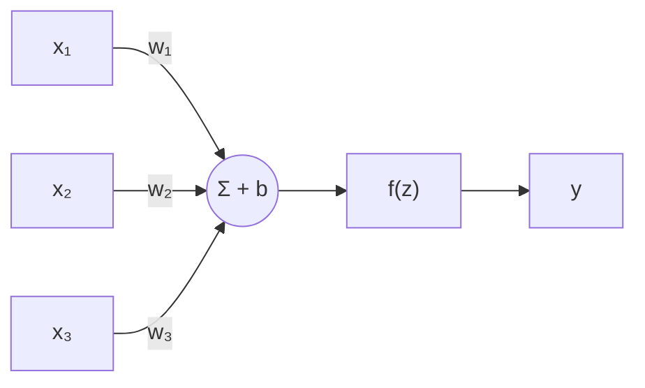
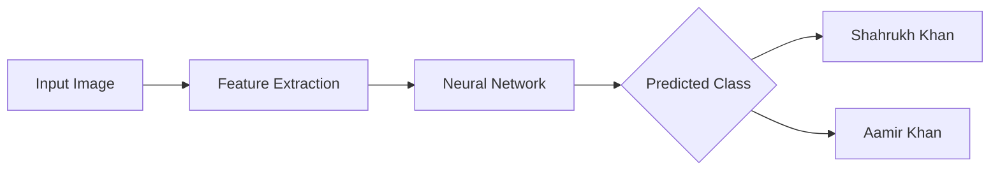
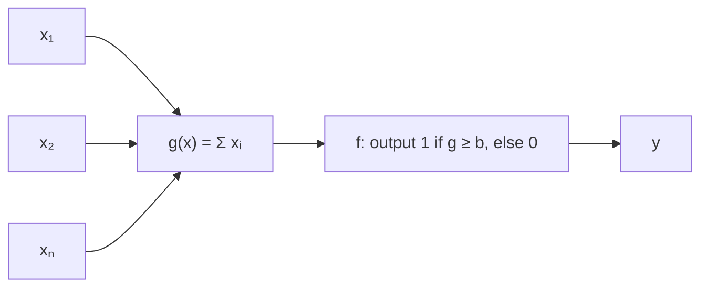

# Deep Learning Notes: From Neurons to the McCulloch-Pitts Model
---

## Table of Contents

- [Deep Learning](#deep-learning)
- [Biological Neuron](#biological-neuron)
- [Artificial Neuron (General Model)](#artificial-neuron-general-model)
- [Classification Example: Shahrukh Khan vs Aamir Khan](#classification-example-shahrukh-khan-vs-aamir-khan)
- [McCulloch-Pitts (MP) Neuron](#mcculloch-pitts-mp-neuron)
  - [Key Properties](#key-properties)
  - [Mathematical Definition](#mathematical-definition)
  - [How to Find the Minimum Threshold b](#how-to-find-the-minimum-threshold-b)
- [Solved Examples (from the Slide)](#solved-examples-from-the-slide)
  - [Logical AND](#logical-and)
  - [Logical OR](#logical-or)
  - [Identity Function](#identity-function)
  - [Inhibitory Function](#inhibitory-function)
- [Extra Practice Problems](#extra-practice-problems)
- [Limitations of the MP Neuron](#limitations-of-the-mp-neuron)
- [Quick Reference Summary](#quick-reference-summary)

---

## Deep Learning

**Deep Learning** is a subset of **Machine Learning** that uses Artificial Neural Networks (ANNs) with multiple hidden layers to learn complex patterns from data. It is loosely inspired by the brain.

**Applications:** image recognition, speech recognition, NLP, self-driving cars, recommendation systems.

---

## Biological Neuron

| Component | Role |
|---|---|
| **Dendrites** | Receive signals from other neurons |
| **Soma (cell body)** | Processes the incoming signals |
| **Axon** | Carries the output signal onward |
| **Synapse** | Junction where one neuron passes a signal to the next |

The brain has billions of interconnected neurons and learns through experience. This is the inspiration for ANNs.

---

## Artificial Neuron (General Model)

**Steps:** receive inputs → multiply by weights → sum → add bias → apply activation → output.

$$
z = \sum_{i=1}^{n} w_i x_i + b
$$

$$
y = f(z)
$$

| Symbol | Meaning |
|---|---|
| $x_i$ | Input $i$ |
| $w_i$ | Weight of input $i$ |
| $b$ | Bias |
| $f(\cdot)$ | Activation function |
| $y$ | Output |



---

## Classification Example: Shahrukh Khan vs Aamir Khan

- **Input features:** face shape, eye shape, hairstyle, beard pattern, facial measurements.
- **Output classes:** Class 1 = Shahrukh Khan, Class 2 = Aamir Khan.
- **Type:** **Binary classification**, since there are only two possible outputs.



---

## McCulloch-Pitts (MP) Neuron

Proposed by **Warren McCulloch and Walter Pitts (1943)**, it was the first mathematical model of an artificial neuron.

### Key Properties

- Inputs are **binary** ($0$ or $1$), and the output is **binary**.
- Two parts: **g** (aggregation) and **f** (threshold decision).
- Inputs can be **excitatory** (they add to the sum) or **inhibitory** (if one is active, the output is forced to $0$).
- There are **no learnable weights**. The threshold $b$ is set by hand.



### Mathematical Definition

**Aggregation (g):**

$$
g(\mathbf{x}) = \sum_{i=1}^{n} x_i
$$

**Decision (f):**

$$
y = f\big(g(\mathbf{x})\big) =
\begin{cases}
1, & g(\mathbf{x}) \ge b \\[4pt]
0, & g(\mathbf{x}) < b
\end{cases}
$$

**With an inhibitory input:**

$$
y = 0 \ \text{ if any inhibitory input is } 1; \quad \text{otherwise } y = f\big(g(\mathbf{x})\big)
$$

Here $b$ is the **threshold (bias)**, written $\theta$ in some textbooks.

### How to Find the Minimum Threshold b

1. For every row where $y=1$, compute $g(\mathbf{x})$ and take the **smallest** value, call it $g_{\min}^{(1)}$.
2. For every row where $y=0$, compute $g(\mathbf{x})$ and take the **largest** value, call it $g_{\max}^{(0)}$.
3. A valid $b$ must satisfy:

$$
g_{\max}^{(0)} < b \le g_{\min}^{(1)}
$$

The **minimum** valid threshold is $b = g_{\max}^{(0)} + 1$.

---

## Solved Examples (from the Slide)


Legend: `──►` is a normal (excitatory) connection, `══►` is a doubled connection (the input is counted twice), and `●` marks an **inhibitory** input.

### Logical AND

```
  x₁ ────────►╭─────┬─────╮
              │  g  │  f  ├────► y
  x₂ ────────►╰─────┴─────╯
```

| x₁ | x₂ | g = x₁ + x₂ | y |
|:-:|:-:|:-:|:-:|
| 0 | 0 | 0 | 0 |
| 0 | 1 | 1 | 0 |
| 1 | 0 | 1 | 0 |
| 1 | 1 | 2 | 1 |

```
g₀ = 1  (largest g where y = 0)
g₁ = 2  (smallest g where y = 1)

1 < b ≤ 2   ⟹   minimum b = 2

Rule:  y = 1  if  x₁ + x₂ ≥ 2
```

---

### Logical OR

```
  x₁ ═══(×2)═►╭─────┬─────╮
              │  g  │  f  ├────► y
  x₂ ═══(×2)═►╰─────┴─────╯
```

| x₁ | x₂ | g = 2x₁ + 2x₂ | y |
|:-:|:-:|:-:|:-:|
| 0 | 0 | 0 | 0 |
| 0 | 1 | 2 | 1 |
| 1 | 0 | 2 | 1 |
| 1 | 1 | 4 | 1 |

```
g₀ = 0,  g₁ = 2

0 < b ≤ 2

Slide answer:  b = 2
Rule:          y = 1  if  2x₁ + 2x₂ ≥ 2
```

> With a **single** line per input, g = x₁ + x₂ and OR needs only **b = 1**.

---

### Identity Function

```
  x  ═══(×2)═►╭─────┬─────╮
              │  g  │  f  ├────► y
              ╰─────┴─────╯
```

| x | g = 2x | y |
|:-:|:-:|:-:|
| 0 | 0 | 0 |
| 1 | 2 | 1 |

```
g₀ = 0,  g₁ = 2

0 < b ≤ 2

Slide answer:  b = 2
Rule:          y = 1  if  2x ≥ 2
```

> With a **single** line, g = x and the identity function needs only **b = 1**.

---

### Inhibitory Function

Implements: **x₁ AND NOT x₂**. The red dot on the slide marks x₂ as inhibitory.

```
  x₁ ────────►╭─────┬─────╮
              │  g  │  f  ├────► y
  x₂ ──────●─►╰─────┴─────╯
           ▲
       inhibitory
```

| x₁ | x₂ | NOT x₂ | y |
|:-:|:-:|:-:|:-:|
| 0 | 0 | 1 | 0 |
| 0 | 1 | 0 | 0 |
| 1 | 0 | 1 | 1 |
| 1 | 1 | 0 | 0 |

```
y = [ g(x) ≥ b ]  AND  (NOT x₂)

Slide:  y = (1 if g(x) ≥ 2) AND (NOT x₂)   ⟹   b = 2
```

How it works:

- If x₂ = 1, the inhibitory input forces y = 0, whatever x₁ is.
- If x₂ = 0, the neuron behaves like a plain threshold unit on x₁.

---
## Extra Practice Problems

**Problem A: NOT gate.** Design an MP neuron for $y = \overline{x}$.
Make $x$ **inhibitory** and set $b = 0$. With $x = 0$: $g = 0 \ge 0$, so $y = 1$. With $x = 1$: the inhibitory input forces $y = 0$.

**Problem B: 3-input AND.** Find $b$ for $y = x_1 \wedge x_2 \wedge x_3$.
$g = x_1 + x_2 + x_3$. Only $(1,1,1)$ gives $y=1$, with $g=3$. The largest $g$ for $y=0$ is $2$.
**Answer: $b = 3$.**

**Problem C: 3-input OR.** Find $b$ for $y = x_1 \vee x_2 \vee x_3$.
The smallest $g$ for $y=1$ is $1$, and the largest for $y=0$ is $0$.
**Answer: $b = 1$** (single connections).

**Problem D: "At least 2 of 3" (majority).**
$g = x_1 + x_2 + x_3$. Rows with $y=1$ have $g \ge 2$, and rows with $y=0$ have $g \le 1$.
**Answer: $b = 2$.**

**Problem E: NOR gate.** $y = \overline{x_1 + x_2}$.
Make both inputs **inhibitory** and set $b = 0$. Then $y = 1$ only when $x_1 = x_2 = 0$.

---

## Limitations of the MP Neuron

- Handles **only binary** inputs and outputs.
- **No learning**: thresholds must be chosen by hand.
- All excitatory inputs count **equally** (no weights).
- Can only represent **linearly separable** functions, so **XOR cannot be implemented** with a single MP neuron.

These limitations led to the **Perceptron**, which adds learnable weights $w_i$ and a learning rule.

---

## Quick Reference Summary

| Gate / Function | Inputs | Excitatory/Inhibitory | $b$ (single lines) | $b$ (slide, doubled lines) |
|---|---|---|:-:|:-:|
| AND (2-input) | $x_1, x_2$ | both excitatory | 2 | 2 |
| OR (2-input) | $x_1, x_2$ | both excitatory | 1 | 2 |
| Identity | $x$ | excitatory | 1 | 2 |
| $x_1 \wedge \overline{x_2}$ | $x_1, x_2$ | $x_2$ inhibitory | 1 | 2 |
| NOT | $x$ | inhibitory | 0 | n/a |
| NOR | $x_1, x_2$ | both inhibitory | 0 | n/a |
| 3-input AND | $x_1, x_2, x_3$ | all excitatory | 3 | n/a |
| 3-input OR | $x_1, x_2, x_3$ | all excitatory | 1 | n/a |
| Majority (2 of 3) | $x_1, x_2, x_3$ | all excitatory | 2 | n/a |

**Recap:** an MP neuron sums binary inputs, fires if the sum reaches the threshold $b$, and any active inhibitory input vetoes the output.
